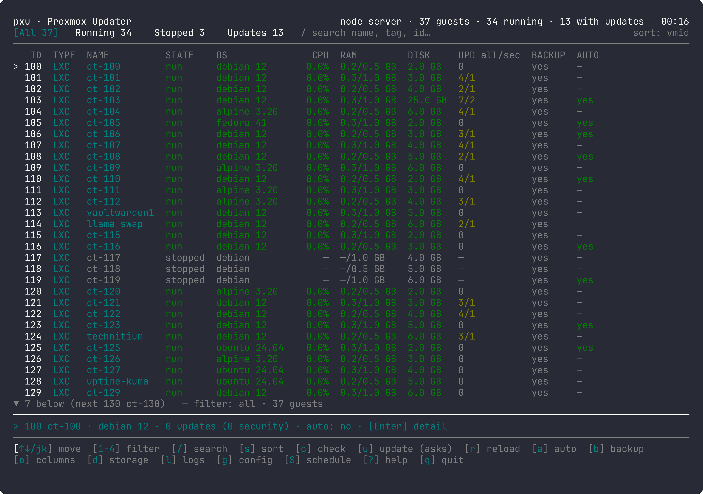
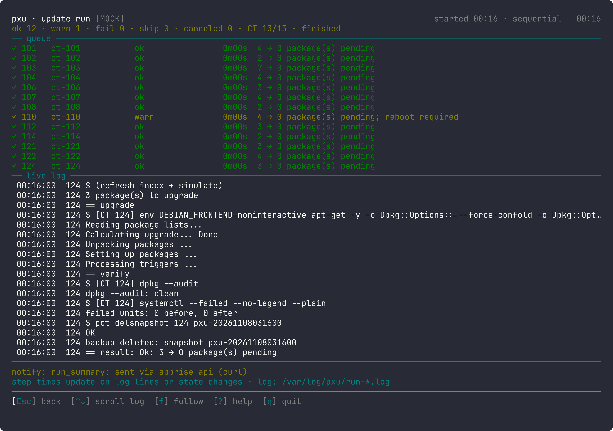
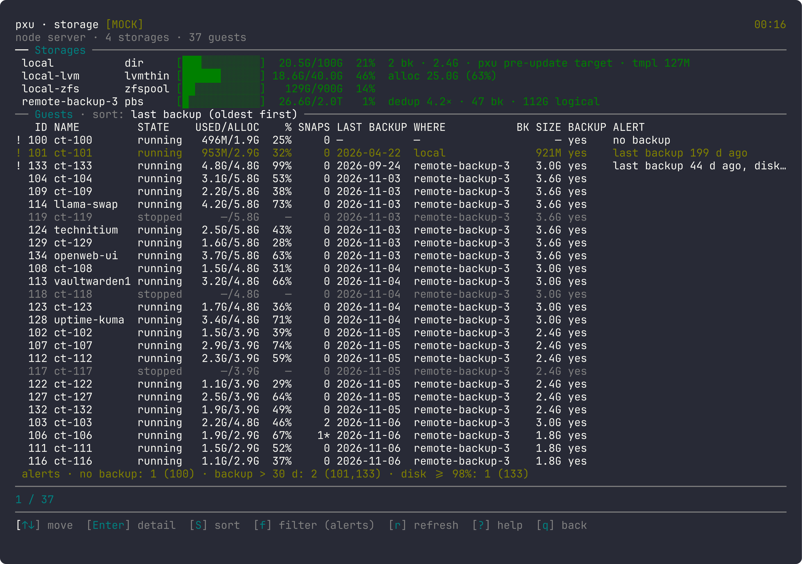
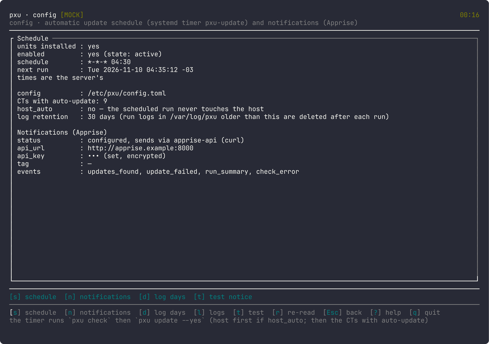
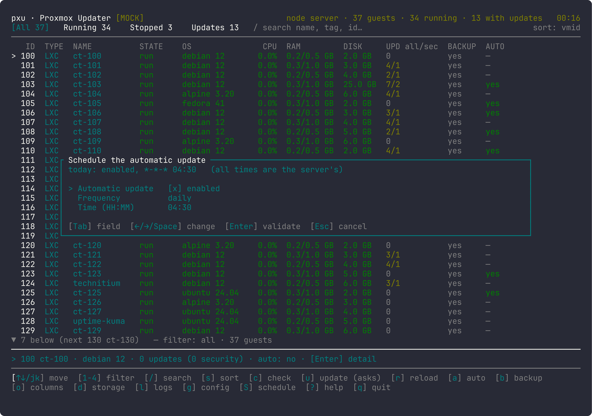
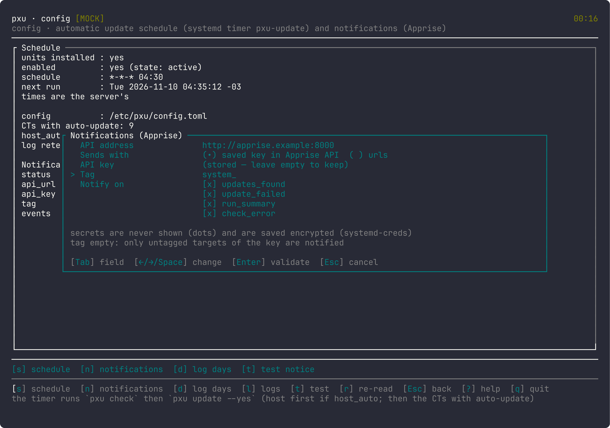
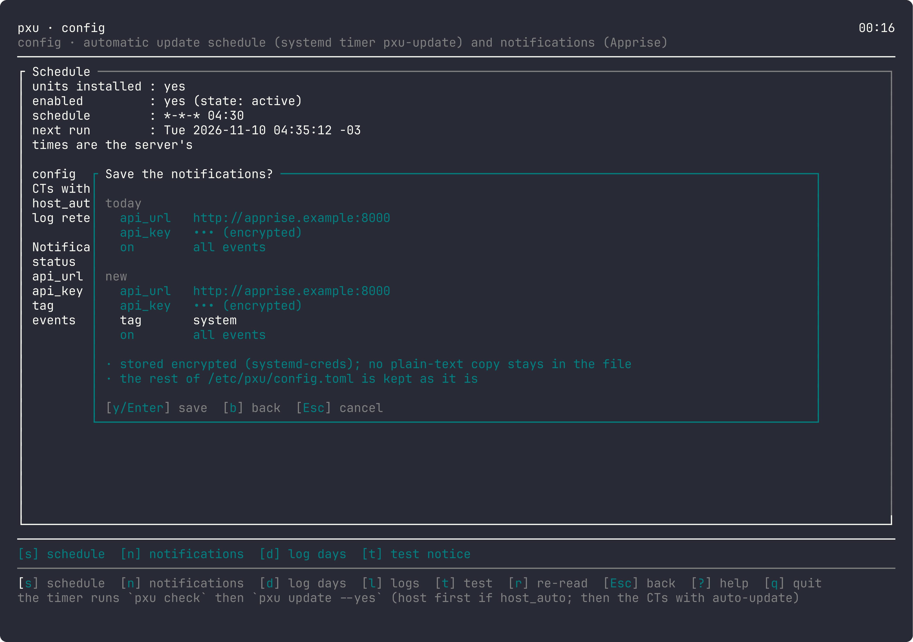

# Proxmox Updater (**pxu**)

[English](README.md) | Español

pxu mantiene al día los contenedores (LXC) de tu servidor Proxmox. Muestra qué contenedores tienen actualizaciones, los actualiza de uno en uno y, si algo sale mal, **vuelve atrás solo** al estado anterior. Puede ejecutarse cada día y avisarte por cualquier servicio compatible con Apprise.





Se usa desde una pantalla en la terminal (la «TUI»). No deja nada corriendo en segundo plano.

## Contenido

- [Requisitos](#requisitos)
- [Instalar](#instalar-pxu)
- [Probar en solo lectura](#probar-pxu-en-modo-solo-lectura)
- [Elegir contenedores](#elegir-qué-contenedores-actualizar)
- [Seguridad y vuelta atrás](#seguridad-y-vuelta-atrás)
- [Actualizaciones automáticas](#activar-las-actualizaciones-automáticas)
- [Avisos](#configurar-los-avisos)
- [Host Proxmox y NVIDIA](#host-proxmox-y-driver-nvidia-opcional)
- [Desinstalar](#desinstalar)
- [Problemas comunes](#problemas-comunes)
- [Más documentación](#más-documentación)

## Requisitos

- Un servidor Proxmox VE, y acceso como `root`.
- Para los avisos (opcional): un servidor [Apprise API](https://github.com/caronc/apprise-api) accesible desde Proxmox.

## Instalar pxu

Pxu se instala en Proxmox desde un binario hecho en otro lado. Puedes descargar la versión firmada o compilarlo tú.

### Opción A: script de instalación

En Proxmox, como root:

```sh
curl -fsSL https://vk2r.github.io/pxu/install.sh | sh
```

Así se instala solo el programa y no queda nada corriendo. La actualización diaria se activa después desde la TUI (ver [Activar las actualizaciones automáticas](#activar-las-actualizaciones-automáticas)).

El script descarga la última [release](https://github.com/vk2r/pxu/releases) (un binario estático que corre en Proxmox 8 y 9, más `dist/`), compara su SHA-256 con el `SHA256SUMS` de la release y la instala; si no coinciden, se detiene sin instalar nada. Para instalar una versión concreta agrega `--release v1.2.3`. Para actualizar, corre el mismo comando: el script dice qué versión hay instalada, se detiene si ya es la última y si no la reemplaza, junto con los timers si estaban instalados. Para leer el script antes de correrlo:

```sh
curl -fsSLo install.sh https://vk2r.github.io/pxu/install.sh
less install.sh
sh install.sh
```

GitHub compila y firma cada release desde su tag. Para comprobar también quién la compiló, verifica la atestación de GitHub en tu equipo (requiere la [CLI de GitHub](https://cli.github.com)): descarga de la release `pxu-<versión>-x86_64-linux.tar.gz` y `provenance.sigstore.json` y ejecuta

```sh
gh attestation verify pxu-<versión>-x86_64-linux.tar.gz --repo vk2r/pxu --bundle provenance.sigstore.json
```

### Opción B: compilarlo tú

Compila pxu en otro equipo (con Rust, vía [mise](https://mise.jdx.dev)) e instálalo en Proxmox.

1. Compila el binario:

   ```sh
   mise install        # una sola vez
   mise run build      # deja el programa en target/release/pxu
   ```

2. Copia `target/release/pxu`, `install.sh` y `dist/` a Proxmox. Por ejemplo, con `scp`:

   ```sh
   ssh root@tu-proxmox mkdir -p /root/pxu-install
   scp target/release/pxu install.sh root@tu-proxmox:/root/pxu-install/
   scp -r dist root@tu-proxmox:/root/pxu-install/
   ```

3. En Proxmox, como root:

   ```sh
   cd /root/pxu-install && sh install.sh ./pxu
   ```

El instalador se puede repetir sin problema y nunca sobrescribe tu configuración. Para actualizar pxu, repite los pasos de la opción que usaste.

## Probar pxu en modo solo lectura

En el servidor, como root:

```sh
pxu
```

pxu corre como root, pero sin archivo de configuración (`/etc/pxu/config.toml`) arranca en **modo solo lectura**, un modo propio de pxu para probarlo sin riesgo: puedes ver tus contenedores y comprobar actualizaciones, pero `u` no actualiza nada. Usa `↑↓` para moverte, `c` para comprobar y `q` para salir. Pulsa `?` para ver todas las teclas. Con `d` abres la página Storage (espacio por storage y por contenedor, con alertas). Para salir del modo solo lectura, cambia cualquier ajuste desde la TUI, por ejemplo marca un contenedor con `a`: pxu crea la configuración y desde ahí `u` actualiza.



## Elegir qué contenedores actualizar

**pxu solo actualiza los contenedores marcados con `a` o con una etiqueta listada en `auto_update_tags` (por ejemplo `autoupdate`). Los demás contenedores no se tocan.**

1. Pulsa `a` en un contenedor. pxu pide confirmación y crea el archivo de configuración.
2. Pulsa `c` para comprobar actualizaciones.
3. Pulsa `u` para actualizar. pxu pide confirmación antes.

Solo se actualizan los contenedores que comprobaste hace menos de una hora.

## Seguridad y vuelta atrás

Con cada contenedor, de uno en uno: copia temporal → simulación → actualización → verificación.

- Si la actualización o la verificación fallan, pxu devuelve el contenedor a su estado anterior y borra la copia.
- Si la restauración falla o la actualización se pasa de tiempo, **la copia se conserva**, la corrida se detiene y el log y el aviso muestran el comando para restaurar a mano.
- Si no hay espacio para la copia, ese contenedor no se toca.
- **La copia cubre solo el disco principal del contenedor.** Los discos montados desde fuera (`/mnt/pve/...`) no entran.
- Puedes desactivar la copia de un contenedor con `b` (entonces tampoco hay vuelta atrás automática).

## Activar las actualizaciones automáticas

La corrida diaria se activa desde la TUI: pulsa `g` para abrir la pantalla **Config** y luego `s`. pxu instala los timers de systemd y desde ahí comprueba y actualiza cada día a las **04:30** (hora del servidor, con un retraso aleatorio de hasta 15 minutos). Actualiza los contenedores marcados como arriba. Los contenedores apagados se omiten por defecto.

En la misma pantalla, `s` también cambia la hora o desactiva la corrida diaria, y `d` define cuántos días se guardan los logs (30 por defecto).





Cada corrida deja un log; ábrelo con `l`.

## Configurar los avisos

Cada corrida termina con **un solo aviso**: una tabla con el servidor primero y luego cada contenedor. Si no se puede enviar, pxu lo reintenta después por sí solo.

1. En Config (`g`), pulsa `n`.
2. Escribe la dirección de tu Apprise API, luego la clave o las URL de destino, y (opcional) una etiqueta y los eventos de los que quieres enterarte.
3. Revisa el resumen y confirma. Las claves nunca se muestran en pantalla y se guardan cifradas.
4. Pulsa `t` para enviar un aviso de prueba.





## Host Proxmox y driver NVIDIA (opcional)

pxu también puede actualizar el propio host Proxmox (selecciona la fila del host y pulsa `u`, o ejecuta `pxu update --host`) y el driver NVIDIA. Ambos están **desactivados** salvo que lo pidas: en la ventana `a` de la fila del host o de un contenedor con GPU está «Include GPU driver update», y `host_auto` en la configuración incluye el host en la corrida diaria. pxu nunca reinicia el servidor. Detalles: [ARCHITECTURE](docs/ARCHITECTURE.es.md) §3.6–3.7.

## Desinstalar

En el servidor, como root:

```sh
./install.sh --uninstall           # quita el programa y la corrida diaria; conserva configuración y logs
./install.sh --uninstall --purge   # además borra tu configuración, el estado y los logs
```

## Problemas comunes

- **"must be run as root"** («hay que ejecutarlo como root») al instalar: ejecuta `install.sh` como root en el servidor.
- **"this machine does not look like Proxmox"** («este equipo no parece Proxmox») al instalar: ejecútalo en el servidor Proxmox, o usa `--force`, que se salta esa comprobación.
- **La TUI no deja actualizar y dice «read-only»** (solo lectura): falta `/etc/pxu/config.toml` o tiene errores. Marca un contenedor con `a`, o revisa el archivo con `pxu config check`.
- **Un contenedor no se actualiza**: tiene que estar marcado con `a` (o tener una etiqueta listada en `auto_update_tags`), y haberlo comprobado con `c` hace menos de una hora.
- **No llegan avisos**: prueba con `t` en Config y revisa la dirección de tu Apprise API. Si pusiste una etiqueta, los destinos en Apprise necesitan esa misma etiqueta.
- **`pxu config check` dice que un secreto está «stored in plain text»**: abre Config → `n` y guarda, o ejecuta `pxu config encrypt-secrets` como root.
- **La lista de Logs está vacía**: aún no hubo ninguna corrida con esta versión.
- **Un log dice `⛔ INCOMPLETE`**: la corrida se cortó (o sigue en marcha). El detalle está en el propio log.

## Más documentación

- [DEVELOPMENT.es.md](DEVELOPMENT.es.md): compilar, probar, capturas y contribuir.
- [docs/ARCHITECTURE.es.md](docs/ARCHITECTURE.es.md): cómo funciona pxu, instalador, configuración, línea de comandos, logs.
- [docs/DESIGN.es.md](docs/DESIGN.es.md): la TUI, pantalla por pantalla, con todas las teclas.
- [docs/SECURITY-REVIEW.es.md](docs/SECURITY-REVIEW.es.md): revisión de seguridad.

## Licencia

MIT
