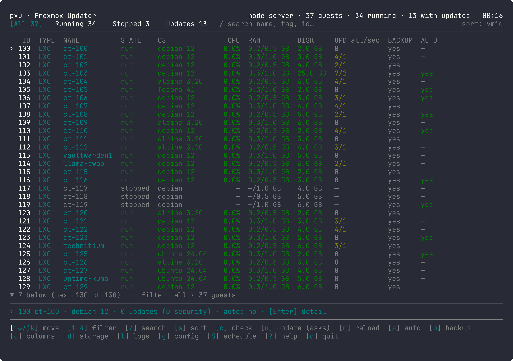
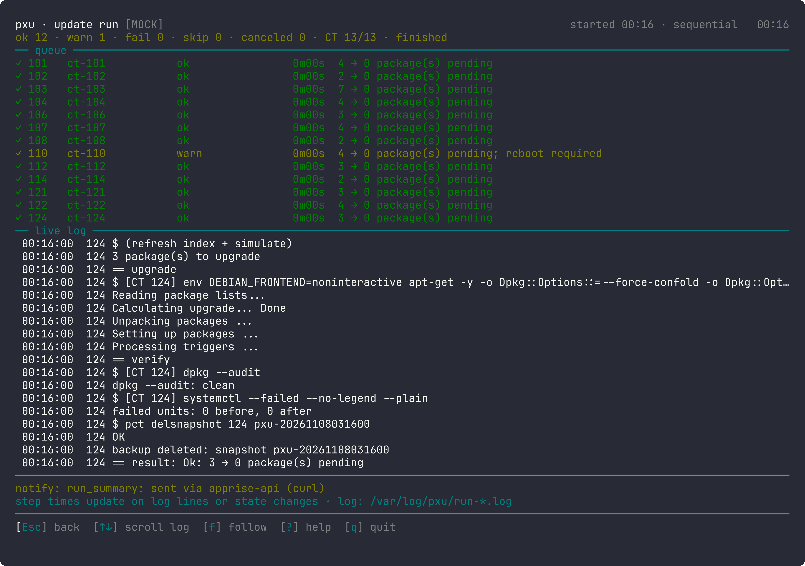
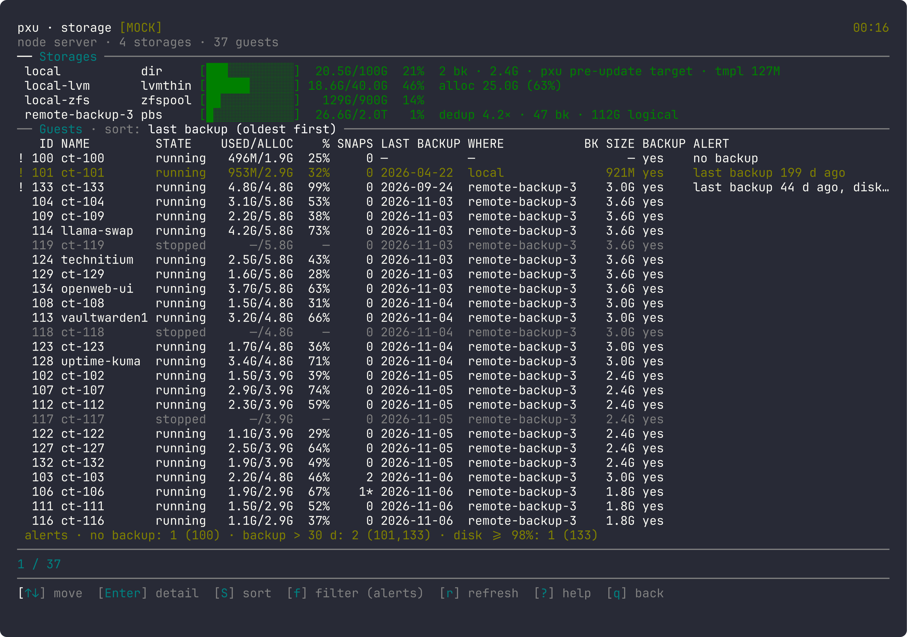
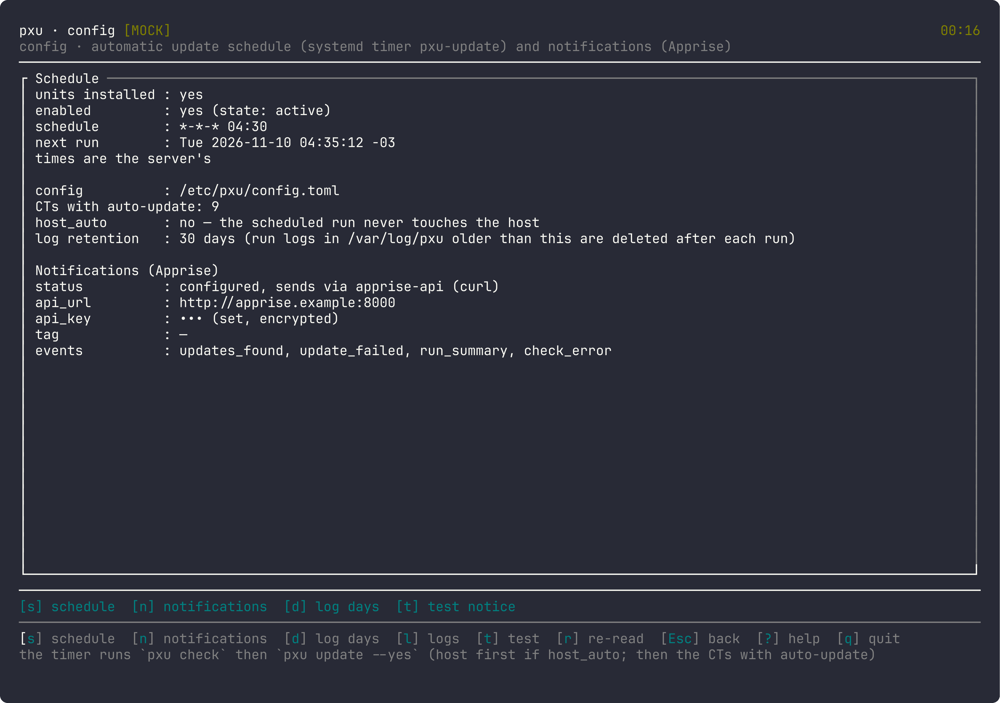
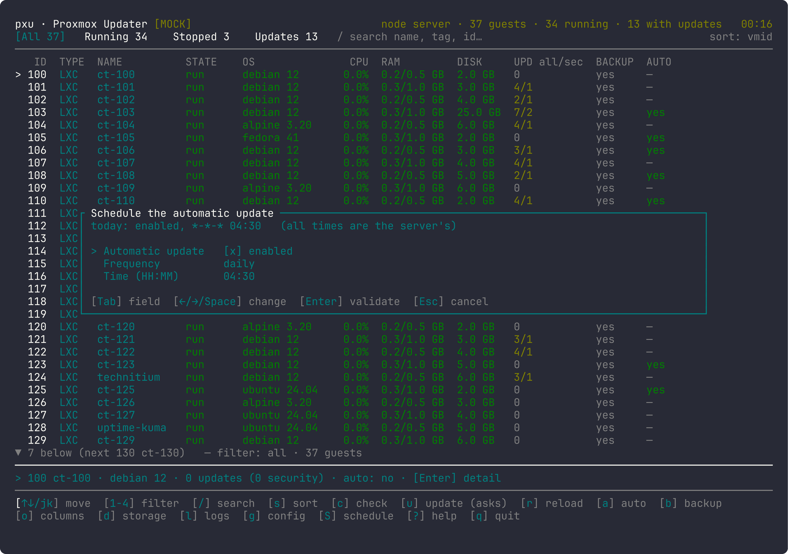
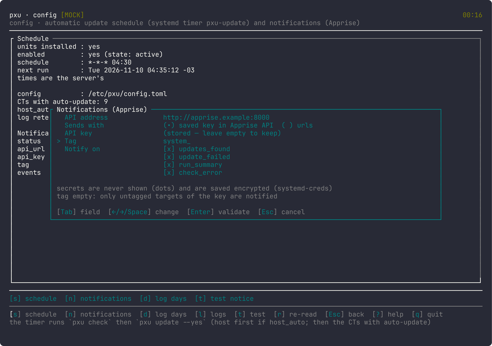
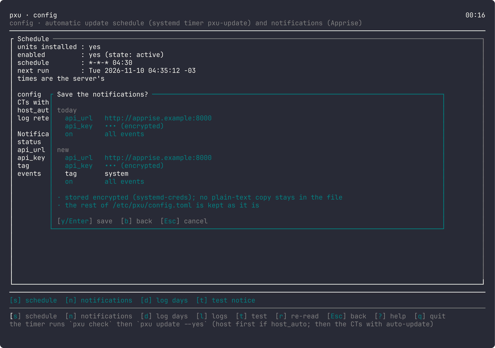

# Proxmox Updater (**pxu**)

English | [Español](README.es.md)

Proxmox Updater keeps the containers (LXC) on your Proxmox server up to date. It shows which containers have updates, updates them one at a time and, if something goes wrong, **rolls back by itself** to the previous state. It can run every day and notify you through any Apprise-compatible service.





You use it from a terminal screen (the "TUI"). It leaves nothing running in the background.

## Contents

- [Requirements](#requirements)
- [Install](#install-pxu)
- [Try it read-only](#try-pxu-in-read-only-mode)
- [Choose containers](#choose-which-containers-to-update)
- [Safety and rollback](#safety-and-rollback)
- [Automatic updates](#enable-automatic-updates)
- [Notifications](#set-up-notifications)
- [Proxmox host and NVIDIA](#proxmox-host-and-nvidia-driver-optional)
- [Uninstall](#uninstall)
- [Common problems](#common-problems)
- [More documentation](#more-documentation)

## Requirements

- A Proxmox VE server, and `root` access.
- For notifications (optional): an [Apprise API](https://github.com/caronc/apprise-api) server reachable from Proxmox.

## Install pxu

Pxu is installed on Proxmox from a binary made elsewhere. You can download the signed release or build it yourself.

### Option A: install script

On Proxmox, as root:

```sh
curl -fsSL https://vk2r.github.io/pxu/install.sh | sh
```

This installs only the program and leaves nothing running. The daily update is turned on later from the TUI (see [Enable automatic updates](#enable-automatic-updates)).

The script downloads the latest [release](https://github.com/vk2r/pxu/releases) (a static binary that runs on Proxmox 8 and 9, plus `dist/`), checks its SHA-256 against the release's `SHA256SUMS` and installs it; it stops before installing anything if they don't match. To install a given version add `--release v1.2.3`. To update, run the same command: the script says which version is installed, stops if it is already the latest and otherwise replaces it, along with the timers if they were installed. To read the script before running it:

```sh
curl -fsSLo install.sh https://vk2r.github.io/pxu/install.sh
less install.sh
sh install.sh
```

Each release is built and signed by GitHub from its tag. To also check who built it, verify GitHub's build attestation on your machine (needs the [GitHub CLI](https://cli.github.com)): download `pxu-<version>-x86_64-linux.tar.gz` and `provenance.sigstore.json` from the release and run

```sh
gh attestation verify pxu-<version>-x86_64-linux.tar.gz --repo vk2r/pxu --bundle provenance.sigstore.json
```

### Option B: build it yourself

Build pxu on another machine (with Rust, via [mise](https://mise.jdx.dev)), then install it on Proxmox.

1. Build the binary:

   ```sh
   mise install        # only once
   mise run build      # leaves the program at target/release/pxu
   ```

2. Copy `target/release/pxu`, `install.sh` and `dist/` to Proxmox. For example, with `scp`:

   ```sh
   ssh root@your-proxmox mkdir -p /root/pxu-install
   scp target/release/pxu install.sh root@your-proxmox:/root/pxu-install/
   scp -r dist root@your-proxmox:/root/pxu-install/
   ```

3. On Proxmox, as root:

   ```sh
   cd /root/pxu-install && sh install.sh ./pxu
   ```

The installer is safe to rerun and never overwrites your configuration. To update pxu, repeat the steps of the option you used.

## Try pxu in read-only mode

On the server, as root:

```sh
pxu
```

pxu runs as root, but without a configuration file (`/etc/pxu/config.toml`) it starts in **read-only mode**, a mode of pxu itself so you can try it safely: you can see your containers and check for updates, but `u` updates nothing. Use `↑↓` to move, `c` to check and `q` to quit. Press `?` for all keys. Press `d` for the Storage page (space per storage and container, with alerts). To leave read-only mode, change any setting from the TUI, for example mark a container with `a`: pxu creates the configuration and from then on `u` updates.



## Choose which containers to update

**pxu only updates containers marked with `a` or with a tag listed in `auto_update_tags` (for example `autoupdate`). All other containers are left untouched.**

1. Press `a` on a container. pxu asks for confirmation and creates the configuration file.
2. Press `c` to check for updates.
3. Press `u` to update. pxu asks for confirmation first.

Only containers you checked less than an hour ago are updated.

## Safety and rollback

For each container, one at a time: temporary backup → dry run → update → verification.

- If the update or the verification fails, pxu restores the container to its previous state and deletes the backup.
- If the restore fails or the update runs over its time limit, **the backup is kept**, the run stops, and the log and the notification show the command to restore by hand.
- If there is no room for the backup, that container is not touched.
- **The backup covers only the container's main disk.** Disks mounted from outside (`/mnt/pve/...`) are not included.
- You can turn the backup off for a container with `b` (then there is no automatic rollback either).

## Enable automatic updates

The daily run is turned on from the TUI: press `g` for the **Config** screen, then `s`. pxu installs the systemd timers and from then on checks and updates every day at **04:30** (server time, with a random delay of up to 15 minutes). It updates the containers marked as above. Stopped containers are skipped by default.

On the same screen, `s` also changes the time or turns the daily run off, and `d` sets how many days of logs are kept (30 by default).





Each run writes one log; open it with `l`.

## Set up notifications

Each run ends with **a single notification**: a table with the server first and then each container. If it cannot be sent, pxu retries it later by itself.

1. In Config (`g`), press `n`.
2. Type the address of your Apprise API, then either the API key or the destination URLs, and (optional) a tag and the events you want to be told about.
3. Review the summary and confirm. Keys are never shown on screen and are saved encrypted.
4. Press `t` to send a test notification.





## Proxmox host and NVIDIA driver (optional)

pxu can also update the Proxmox host itself (select the host row and press `u`, or run `pxu update --host`) and the NVIDIA driver. Both are **off** unless you ask for them: in the `a` window of the host row or of a container with a GPU you will find «Include GPU driver update», and `host_auto` in the configuration includes the host in the daily run. pxu never reboots the server. Details: [ARCHITECTURE](docs/ARCHITECTURE.md) §3.6–3.7.

## Uninstall

On the server, as root:

```sh
./install.sh --uninstall           # removes the program and the daily run; keeps configuration and logs
./install.sh --uninstall --purge   # also deletes your configuration, state and logs
```

## Common problems

- **"must be run as root"** during install: run `install.sh` as root on the server.
- **"this machine does not look like Proxmox"** during install: run it on the Proxmox server, or use `--force`, which skips that check.
- **The TUI won't let you update and says "read-only"**: `/etc/pxu/config.toml` is missing or has errors. Mark a container with `a`, or check the file with `pxu config check`.
- **A container doesn't update**: it must be marked with `a` (or have a tag listed in `auto_update_tags`), and you must have checked it with `c` less than an hour ago.
- **Notifications don't arrive**: test with `t` in Config and check the address of your Apprise API. If you set a tag, the destinations in Apprise need the same tag.
- **`pxu config check` says a secret is "stored in plain text"**: open Config → `n` and save, or run `pxu config encrypt-secrets` as root.
- **The Logs list is empty**: there hasn't been a run with this version yet.
- **A log says `⛔ INCOMPLETE`**: the run was cut off (or is still in progress). The details are in the log itself.

## More documentation

- [DEVELOPMENT.md](DEVELOPMENT.md): build, test, screenshots and contribute.
- [docs/ARCHITECTURE.md](docs/ARCHITECTURE.md): how pxu works, installer, configuration, command line, logs.
- [docs/DESIGN.md](docs/DESIGN.md): the TUI, screen by screen, with all keys.
- [docs/SECURITY-REVIEW.md](docs/SECURITY-REVIEW.md): security review.

## License

MIT
